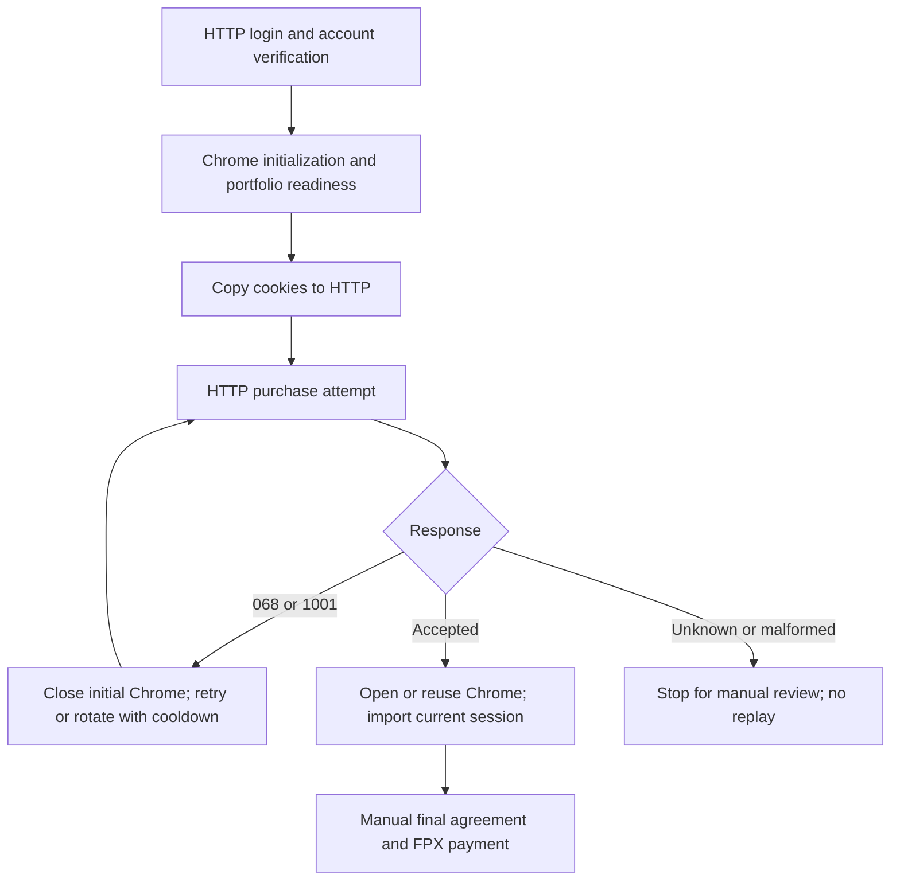

<p align="center">
  
</p>

<h1 align="center">MyASNB Buyer Automation</h1>

<p align="center">
  <strong>Stop refreshing. Let the bot retry for you.</strong>
</p>

<p align="center">
  
  
  
  
</p>

<p align="center">
  <a href="https://ko-fi.com/yenwee"></a>
</p>

---

## Overview

Automates MyASNB login, fund selection and purchase retries using your configured
account, fund, amount and bank. On subscription acceptance, it notifies you and
pauses for the final agreement and FPX bank payment in Chrome. Payment is manual.

- CLI, desktop GUI and localhost web dashboard; multiple account profiles.
- HTTP purchasing by default, with temporary Chrome session initialization.
- Insufficient-unit retries (`068`), fund cooldowns (`1001`) and session recovery.
- Optional email alerts, per-profile logs and local diagnostic captures.

## Quick Start

Install Python 3.11+ and Google Chrome. Brave is a macOS fallback.

### macOS / Linux

```bash
git clone https://github.com/yenwee/asnb_buyer_app.git
cd asnb_buyer_app
make setup
# Edit config.ini and add a [Profile.<name>] section.
make run P=yourprofile
```

### Windows

```bat
git clone https://github.com/yenwee/asnb_buyer_app.git
cd asnb_buyer_app
setup.bat
rem Edit config.ini and add a [Profile.<name>] section.
run.bat yourprofile
```

### Launchers

| Command | Action |
| --- | --- |
| `make run P=<profile>` | Run one profile; defaults to initialized HTTP. |
| `make run` | List profiles. |
| `make gui` | Desktop GUI with account tabs (`gui.bat` on Windows). |
| `make web` | Open the local dashboard at `http://127.0.0.1:8765`. |
| `make tail` | Follow logs. |
| `make stop` | Stop runners. |

The web dashboard can edit profiles and start/stop/resume runners with live logs.
Use `PORT=9000 make web` to change its port.

## Configuration

Copy `config.ini.template` to `config.ini` if setup has not already done so.
Each `[Profile.<name>]` is one account; missing settings fall back to `[Settings]`.
Keep credentials in the ignored `config.ini`.

```ini
[Profile.ali]
username = your_login_id
password = your_password
bank_name = Maybank2U
purchase_amount = 1000
funds_to_try = Amanah Saham Malaysia, Amanah Saham Malaysia 2 Wawasan
recipient_email = you@example.com

[Settings]
funds_to_try = Amanah Saham Malaysia 2 Wawasan
purchase_amount = 100
bank_name = Public Bank
referral_code =
loop_tries = 0
session_refresh_interval = 6
browser_memory_limit_mb = 3072
network_trace = true
lean_assets = true
page_load_strategy = eager
api_reads = true
api_purchase_timeout_seconds = 60
```

`purchase_amount` is RM per attempt; `loop_tries = 0` runs continuously. In API
mode, a positive value caps fund turns at that value times the configured fund
count; skipped cooldowns do not consume a turn.
Fund codes resolve from portfolio metadata: ASM → `ASM`, ASM 2 Wawasan → `ASW`,
ASM 3 → `AS1M`. Holdings printed after login are current investments, not a bank
balance or a count of units available to buy.

`lean_assets` skips observed promotional images while retaining application and
security resources. Set it to `false` and `page_load_strategy` to `normal` for
standard loading. `api_reads` controls optional API reads in UI mode; the default
API runner always requires account/fund/bank metadata reads. The subscription read
timeout accepts 20–180 seconds globally or per profile.

Session health/memory settings apply to the UI flow: healthy logins stay active;
sustained process-tree memory pressure can schedule a browser restart outside
payment/review pauses. The HTTP runner reinitializes on read-time session expiry.
See the template comments for additional settings and bank names.

### Email notifications

```ini
[Email]
smtp_server = smtp.gmail.com
smtp_port = 587
sender_email = you@example.com
sender_password = your_app_password
recipient_email = you@example.com
send_on_success = true
```

Gmail requires an App Password. Each profile can override the recipient.
Desktop payment alerts and the manual payment prompt do not wait for SMTP.

## Purchase Flow



The default uses HTTP login and metadata reads without opening a purchase form.
Before the first eligible attempt, Chrome loads the normal portal and the runner
waits for its authenticated portfolio request to finish. Its initialized cookies
are copied back to HTTP. After the first explicit `068`/`1001` rejection, Chrome
closes; later HTTP attempts reuse the session without reopening it. Session expiry
starts a fresh login/initialization cycle.

API mode attempts one eligible fund per turn in configured order, then repeats.
After `068`, it waits 3–8 seconds and moves to the next eligible fund rather than
exhausting a retry batch on one fund. `1001` applies the server-directed cooldown
and rotates funds. Initial investment terms remain
accepted in the API payload, preserving the original automated flow.

When all funds are cooling down, logs show each remaining countdown and the next
eligible fund. Status updates occur at most 60 seconds apart, with an earlier
wake when the first cooldown expires. Repeated portfolio reads preserve existing
countdowns; a new explicit block starts a fresh server-directed wait.
When a hold starts or its reason changes, logs identify every affected fund and
distinguish fund blocks/inactivity, maintenance, business hours, disabled
subscriptions and bank availability. Every turn fetches fresh preflight eligibility;
purchase context reuses that response while it is under 30 seconds old. An expired
cached response is refreshed before use.

On acceptance, Chrome opens or is reused with the current session and navigates
to the final agreement page. Its final checkbox stays unchecked and payment stays
disabled until you accept manually. After payment/review, Enter resumes the runner;
Ctrl+C stops it. Subscription acceptance is not completed FPX payment.

Timeouts, HTTP 524, unrecognized rejections, malformed responses and failed
handoffs stop automatic submissions for review. Check transaction history and
any pending payment before starting another run. Missing/delayed history does
not prove failure; uncertain requests have no automatic retry or transport fallback.

### Transport overrides

```bash
make run P=ali                                      # Initialized HTTP (default)
make run P=ali API_SUBSCRIPTION_TRANSPORT=chrome     # API fetch with Chrome kept open
make run P=ali TRANSPORT=ui                         # Original form-based UI flow

# Equivalent default CLI:
python -m asnb.main --profile ali
```

GUI/web launches use the same HTTP default. Restart existing runners to load
changes. Startup should report `Purchase transport: api` and
`subscription transport=http`.

User runs received HTTP 200 / `068`, including four HTTP requests after Chrome
closed. Browser-free and delay-only initialization experiments returned 524 and
were removed. The precise timeout cause remains unverified. Accepted-order
reopening and FPX completion through the final runner remain unverified; dummy
confirmation rendering and cookie transfer have separate live/offline checks.

## Logs and Troubleshooting

Logs include transport, timing, HTTP status and business codes without passwords,
cookie values or signed FPX fields. Passive Chrome metadata traces under
`network_traces/` contain hashed endpoint IDs and rotate at 1 MiB with three
backups per runner. Chrome telemetry covers only the browser's active lifetime.

Separate `*.purchase-private.jsonl` captures retain complete observed Chrome
purchase request/response bodies and can contain sensitive payment data. They use
owner-only files on macOS/Linux. Keep captures, screenshots and logs local; they
are ignored by Git. Set `network_trace = false` to disable Chrome collection.

| Problem | Action |
| --- | --- |
| Login rejected or active-session conflict | Check credentials/session status; HTTP login stops without credential retries. |
| HTTP 524, timeout or REVIEW | Inspect transaction history/pending payment. Do not assume the order failed. |
| Bank unavailable | Match its display name in `config.ini.template`, such as `Maybank2U`. |
| UI elements or funds missing | Portal structure/session state may have changed; inspect local diagnostics. |
| WebDriver setup fails | Confirm Chrome/Brave is installed and inspect the driver error. |
| Email missing | Verify SMTP/App Password and spam folder; payment remains manual. |

## Tests

Python tests mock purchase/payment calls:

```bash
.venv/bin/python -m unittest discover -s tests -q
```

Offline browser checks require Node.js and Chrome. Install Playwright, then fetch
pinned public frontend assets using GET requests only:

```bash
npm install --no-save --package-lock=false playwright@1.57.0
.venv/bin/python tests/fetch_handoff_assets.py
node tests/browser_handoff_smoke.cjs
node tests/browser_transport_smoke.cjs
```

Set `PLAYWRIGHT_MODULE` to the package directory if installed outside normal Node
resolution. Asset downloads are SHA-256 verified against
`tests/fixtures/portal-assets.json` and stored in ignored `output/playwright/handoff/`.
Changed/unavailable assets require contract/manifest review. Browser tests use
dummy fixtures and intercept every URL; they never attach to your authenticated
browser or send live purchase/payment requests.

## Architecture

| Files | Responsibility |
| --- | --- |
| `main.py`, `api_runner.py` | Launch/configuration, UI orchestration and HTTP runner lifecycle. |
| `http_portal.py`, `api.py` | HTTP authentication, restricted writes and read-only metadata/history. |
| `browser_transport.py`, `handoff.py` | Portal readiness, cookie transfer, Chrome fetch and confirmation state. |
| `driver.py`, `assets.py`, `health.py`, `popups.py`, `purchase_state.py` | Browser setup, loading, health checks, popup/outcome handling. |
| `network.py`, `email.py` | Local telemetry and notifications. |
| `config.py`, `gui.py`, `web.py` | Profiles and launch interfaces. |

## Disclaimer

This tool automates browser interactions with the MyASNB portal using **your own credentials** for **personal use**. It does not bypass any security measures, CAPTCHAs, or access controls.

- **Use at your own risk.** We are not responsible for any financial loss, account suspension, or other consequences.
- **Website changes may break functionality.** ASNB may update their portal at any time.
- **This is not financial advice.** Decide independently whether to invest in ASNB funds.
- **FPX payments are always manual.** The script pauses and waits for you to complete payment yourself.
- **Not affiliated with ASNB or PNB.** This is an independent open-source project.

## Contributing

Contributions welcome! Check out the [open issues](https://github.com/yenwee/asnb_buyer_app/issues) -- several are tagged `good first issue`.

## License

MIT License -- see [LICENSE](LICENSE) for details.
